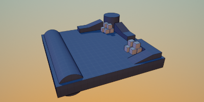

# UE Default Template

A Blueprint-only Unreal Engine 4.27 project template built to accelerate the initial setup of new game projects. Includes a pre-configured render pipeline, base Blueprints, post-process materials, UI widgets, and audio setup — ready to use out of the box.



## Requirements

- Unreal Engine 4.27

## Installation

1. Clone or download this repository
2. Rename the folder following the Unreal template naming convention:
   ```
   TP_<ProjectName>BP
   ```
   - `TP_` prefix identifies it as a template
   - `BP` suffix indicates it is a Blueprint-only project
   - Example: `TP_DefaultTemplateBP`, `TP_PlatformerBP`, `TP_TopDownBP`
3. Place the renamed folder inside your UE4 templates directory:
   ```
   Epic Games/UE_4.27/Templates/
   ```
4. Restart the Unreal Engine launcher
5. The template will appear under **Games** when creating a new project

## What's Included

### Blueprints
| Asset | Description |
|---|---|
| `BP_Default_GameMode` | Base game mode |
| `BP_Default_PlayerController` | Base player controller |
| `BP_DefaultGameInstance` | Base game instance |
| `BP_Player_Character` | Base player character |
| `BP_Default_Interface` | Base interface |
| `TriggerBox_Blueprint` | Generic trigger volume |
| `BP_Backdrop` | Environment backdrop actor |

### Maps
| Map | Purpose |
|---|---|
| `Menu_Level` | Default game startup map |
| `Empty_Level` | Editor startup map |

### Post-Process Materials
- Cel Shading
- Outline (V2)
- Stylized Fog
- Cheap Fog
- Depth Draw
- Highlight Shader
- Pixelate
- Radial Blur
- Physics Cel Shading

### Materials & Utilities
- Auto Grid developer material
- Backdrop environment material
- Vertex Snap material function
- World Master Parameters collection
- Cubemap sky materials
- Dither textures

### UI Widgets
- `Pause_Menu_WB` — pause menu
- `Settings_WB` — settings screen
- `UserWidgetMacroLibrary` — shared widget macros

### Audio
- `MasterSoundMix`
- `MasterSoundClass`
- `MusicSoundClass`

## Render Configuration

The template ships with a performance-focused render setup targeting Desktop / Maximum quality with Forward Shading:

| Setting | Value | Reason |
|---|---|---|
| Shading Model | Forward | Better performance in most game scenes |
| Anti-Aliasing | MSAA x4 | Clean edges without TAA ghosting |
| Motion Blur | Disabled | Cost reduction |
| Bloom | Disabled | Cost reduction |
| Ambient Occlusion | Disabled | Cost reduction |
| Auto Exposure | Disabled | Not suited for stylized lighting |
| Ray Tracing | Disabled | Perf budget |
| Nanite | Disabled | UE4 compatibility |
| Virtual Textures | Disabled | Not needed by default |
| Custom Depth | Enabled (Stencil) | Required for outline post-process |
| Mesh Distance Fields | Enabled | Soft shadow support |
| Skin Cache | Enabled | Animation performance |
| Default RHI | DX11 | Broad compatibility |

All settings are documented with comments inside `Config/DefaultEngine.ini`.

## License

This project is licensed under the [MIT License](LICENSE).
